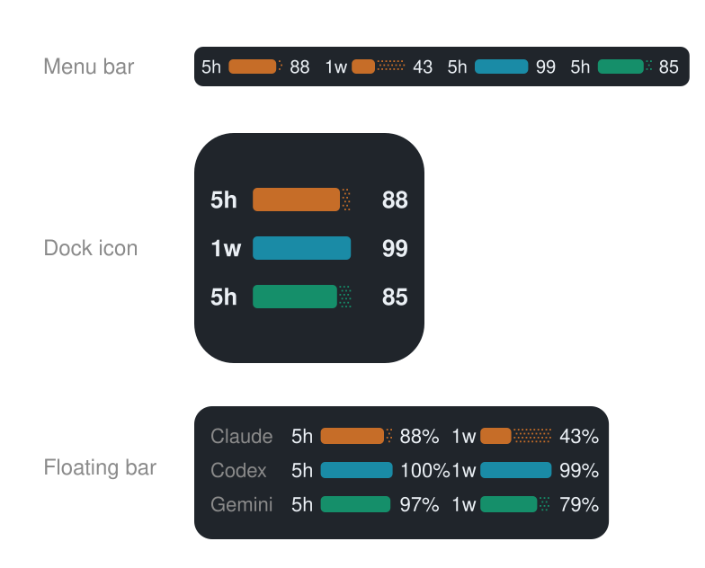

🇬🇧 [English](README.md) · 🇯🇵 [日本語](README.ja.md) · 🇪🇸 [Español](README.es.md) · 🇸🇦 [العربية](README.ar.md) · 🇫🇷 [Français](README.fr.md) · 🇩🇪 [Deutsch](README.de.md) · 🇨🇳 [简体中文](README.zh.md) · 🇰🇷 [한국어](README.ko.md) · 🇧🇷 [Português](README.pt.md) · 🇳🇱 [Nederlands](README.nl.md) · 🇮🇹 Italiano · 🇻🇳 [Tiếng Việt](README.vi.md) · 🇮🇩 [Bahasa Indonesia](README.id.md) · 🇹🇭 [ไทย](README.th.md)

# 🎚️ AI Usage Barometer

**Monitora Claude, Codex e Gemini a colpo d'occhio in tempo reale su 3 superfici Mac: barra dei menu, icona del Dock e barra fluttuante.**

| Servizio IA | Colore | Fonti supportate |
|:---|:---|:---|
| **Claude** |  `#C66D28` | Claude Code (barra di stato ufficiale) |
| **Codex** |  `#1A8BA6` | Codex CLI e token web |
| **Gemini** |  `#158F6A` | Quote di sessione Google Antigravity Desktop & IDE |



## ⚡ Installazione — incolla questa riga nel Terminale

```bash
/bin/bash -c "$(curl -fsSL https://raw.githubusercontent.com/taka-avantgarde/ai-usage-barometer/main/install-app.sh)"
```

Questa è l'app. Niente Homebrew, niente Xcode, niente SwiftBar. macOS 13 o successivo. Al primo avvio chiede dove vuole abitare — barra dei menu, icona del Dock o barra fluttuante — e dal suo menu si cambia idea quando si vuole.

Usi già SwiftBar, o lo preferisci? Questa riga installa il plugin al suo posto, portando Homebrew e SwiftBar solo se mancano. Rieseguirla è sicuro: usa la stessa riga anche per aggiornare.

```bash
/bin/bash -c "$(curl -fsSL https://raw.githubusercontent.com/taka-avantgarde/ai-usage-barometer/main/install.sh)"
```

## Un solo elemento nella barra dei menu

Claude, Codex e Gemini condividono un elemento, separati da una linea sottile. Le barre sono in stile batteria: **la parte piena è la capacità rimasta**, la coda punteggiata è ciò che è stato consumato. Anche le percentuali indicano il residuo.

```text
5h ███░·  1w ██░░·  │  5h ████·  1w ███░·  │  5h ████·  1w ███░·
└──── Claude ────┘     └───── Codex ─────┘     └──── Gemini ────┘
```

La barra dei menu è disegnata come immagine vettoriale, così ogni servizio mantiene il proprio colore in un unico elemento. Altrimenti si passa automaticamente al testo semplice.

Entrambe le palette usano colori saturi e ad alto contrasto: Claude usa
l’arancione e Codex il ciano. Con l’11–30% rimanente, l’avviso incorpora
arancione; con il 10% o meno, lo stato critico incorpora rosso vivo. Codex
mantiene una forte componente blu in entrambe le miscele:

| Fase | Uso | Claude | Codex | Gemini |
|---|---:|---|---|---|
| normale | 0–69% usato |  `#C66D28` |  `#1A8BA6` |  `#158F6A` |
| attenzione | 70–89% usato |  `#B65A1E` |  `#52768A` |  `#5E7B3A` |
| critico | 90–100% usato |  `#C52E22` |  `#783F78` |  `#8C3B5A` |

## Impostazioni

Apri il menu e scegli **⚙ Display settings**. Il pannello resta aperto, così puoi modificare più opzioni di seguito senza riaprirlo dopo ogni clic. Le modifiche hanno effetto immediato.

L’interfaccia del plugin è disponibile solo in inglese. Questa documentazione GitHub resta disponibile in 14 lingue.

| Impostazione | Effetto |
|---|---|
| Mostra Claude | Mostra o nascondi Claude |
| Mostra Claude 5h | Mostra o nascondi la finestra di 5 ore |
| Percentuale di Claude 5h | Mostra o nascondi la relativa percentuale |
| Mostra Claude 1w (7d) | Mostra o nascondi la finestra di 7 giorni |
| Percentuale di Claude 1w (7d) | Mostra o nascondi la relativa percentuale |
| Mostra Codex | Mostra o nascondi Codex |
| Mostra finestra 1 di Codex | Mostra o nascondi la prima finestra restituita da Codex (e.g. Codex 5h) |
| Percentuale finestra 1 di Codex | Mostra o nascondi la relativa percentuale (e.g. Codex 5h) |
| Mostra finestra 2 di Codex | Mostra o nascondi la seconda, se presente (e.g. Codex 7d) |
| Percentuale finestra 2 di Codex | Mostra o nascondi la relativa percentuale (e.g. Codex 7d) |
| Mostra Gemini | Mostra o nasconde Gemini |
| Mostra Gemini 5h / % | Mostra o nasconde la finestra 5h e la sua percentuale |
| Mostra Gemini 1w / % | Mostra o nasconde la finestra 1 settimana (7d) e la sua percentuale |
| Intervallo di aggiornamento | 1, 3 o 5 minuti |

Quando tutti gli indicatori sono nascosti, rimane una voce neutra `AI …` per aprire le impostazioni. Il colore dipende solo dalle barre visibili. Le impostazioni sono in `~/.cache/claude-codex-bar/` e sopravvivono agli aggiornamenti.

Disattivando Claude o Codex, l’aggiornamento dei dati di quel servizio viene sospeso. Le impostazioni 5h, 7d e percentuale restano attenuate e bloccate; i valori precedenti vengono ripristinati quando il servizio viene riattivato.

Se le finestre 5h e 7d di un servizio sono entrambe deselezionate, il servizio e i relativi errori vengono nascosti completamente e la sua origine dati non viene interrogata.

Il plugin controlla GitHub Releases al massimo una volta al giorno. Se è disponibile un aggiornamento dell’operatore, menu e impostazioni mostrano avviso, note e **Aggiorna ora**.

## L'app — scegli dove abita

La barra dei menu non è sempre disponibile. Su alcuni Mac l'elemento di stato
viene collocato fuori dallo schermo e non viene mai disegnato, e accanto al
notch può semplicemente non esserci spazio. L'app mette gli stessi indicatori
dove decidi tu.

| Posto | Che cos'è |
|---|---|
| **Barra dei menu** | L'elemento di stato dell'app stessa, su una riga |
| **Icona del Dock** | L'icona del Dock diventa l'indicatore. Non occupa schermo |
| **Barra fluttuante** | Una piccola barra sempre in primo piano. Trascinala dove vuoi |

I tre sono indipendenti: attiva la combinazione che preferisci. Fai clic destro
sulla barra, sull'icona del Dock o sull'elemento della barra dei menu per le
impostazioni: ogni servizio attivo o no, le percentuali, dove abita e
**Details…** per il pannello con i tempi di recupero.

Spegnere un indicatore restituisce la larghezza: l'elemento si stringe su quel che resta, e la barra dei menu si tiene la differenza.

Una freccia arancione segnala un aggiornamento in attesa. **Update to vX.Y.Z**, nello stesso menu, lo installa sul posto.

Una riga sola, senza Xcode. macOS 13 o successivo.

```bash
/bin/bash -c "$(curl -fsSL https://raw.githubusercontent.com/taka-avantgarde/ai-usage-barometer/main/install-app.sh)"
```

L'app è firmata e autenticata da Apple, quindi si apre subito dopo il download: nessun avviso, nessun clic destro.

Oppure eseguila dai sorgenti, e in quel caso serve Xcode:

```bash
git clone https://github.com/taka-avantgarde/ai-usage-barometer.git
cd ai-usage-barometer/app && swift run
```

Le impostazioni sono condivise con il plugin SwiftBar, quindi i due non
divergono mai.

## Origini dei dati

**Claude** viene letto dall’endpoint OAuth `api.anthropic.com/api/oauth/usage`, con il token che Claude Code salva già nel portachiavi di macOS (`Claude Code-credentials`, altrimenti `~/.claude/.credentials.json`). Non vi si scrive nulla e il token lascia il Mac solo nella richiesta ad Anthropic. Al primo avvio scegli **Consenti sempre**.

I risultati sono memorizzati per la durata dell’intervallo, quindi l’endpoint viene interrogato al massimo una volta per intervallo. Se un aggiornamento fallisce, resta l’ultimo valore valido.

**Codex** viene letto dall’helper locale `codex-usage.sh` che l’installer colloca in `~/SwiftBar/.ai-usage-barometer/`. Le sue finestre sono dinamiche per numero e nome — un cambio di piano può trasformare `5h`/`7d` in qualcosa come `30d` — quindi i due interruttori sopra seguono la prima e la seconda finestra effettivamente restituite da Codex, e il pannello impostazioni si rinomina di conseguenza.

**Gemini** viene letto dall'helper locale `gemini-usage.sh` in `~/SwiftBar/.ai-usage-barometer/`. Traccia le quote `5h` e `1w` (`7d`) di Antigravity Desktop App 2.0 e Antigravity IDE tramite Connect RPC locale (`RetrieveUserQuotaSummary` / `GetUserStatus`), SQLite (`state.vscdb`) e cache.

## Risoluzione dei problemi

**Compare un avviso di Claude.** Apri il menu a tendina per vedere il motivo. *Sign in to Claude Code again* significa che il token OAuth è scaduto — accedi di nuovo tramite la CLI di Claude Code o l’estensione IDE. **Non è l’app desktop Claude**: accedere a Claude.app non rinnova questo token. *Rate limited* si risolve da solo; il plugin attende 15 minuti e mostra il tempo rimanente.

**Compare un avviso di Codex.** L’helper manca o Codex non ha ancora prodotto dati. Riesegui l’installer e usa Codex CLI una volta.

**Gemini mostra un avviso.** Antigravity non è ancora stato avviato o l'helper locale è in attesa di dati. Avvia Antigravity Desktop o Antigravity IDE.

**I colori differiscono tra barra e menu.** macOS può trattare una barra traslucida come chiara mentre i menu sono scuri. Il renderer vettoriale a due colori viene usato quando Python è disponibile; il testo a un colore è solo il fallback quando Python non è disponibile.

## Disinstallazione

```bash
curl -fsSL https://raw.githubusercontent.com/taka-avantgarde/ai-usage-barometer/main/uninstall.sh | bash
```

## Licenza

[MIT](LICENSE) © 2026 Takayuki Miyano · Atlas Associates Inc.
